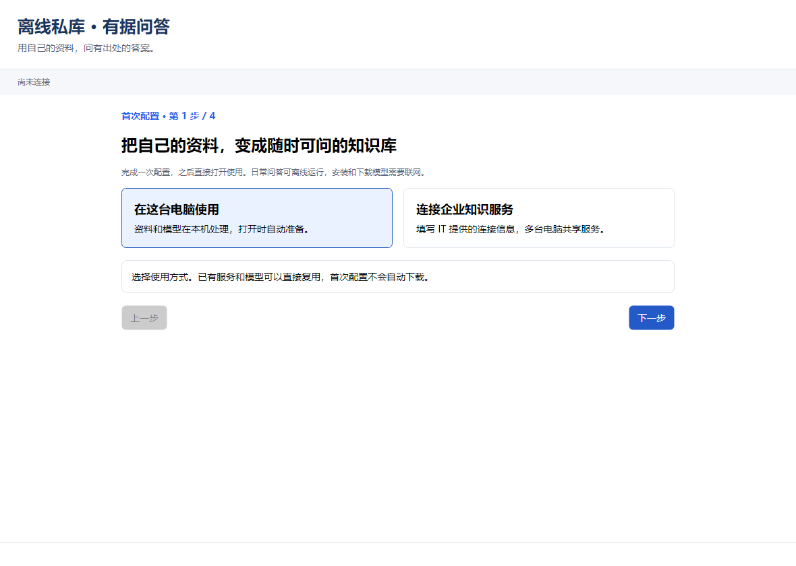
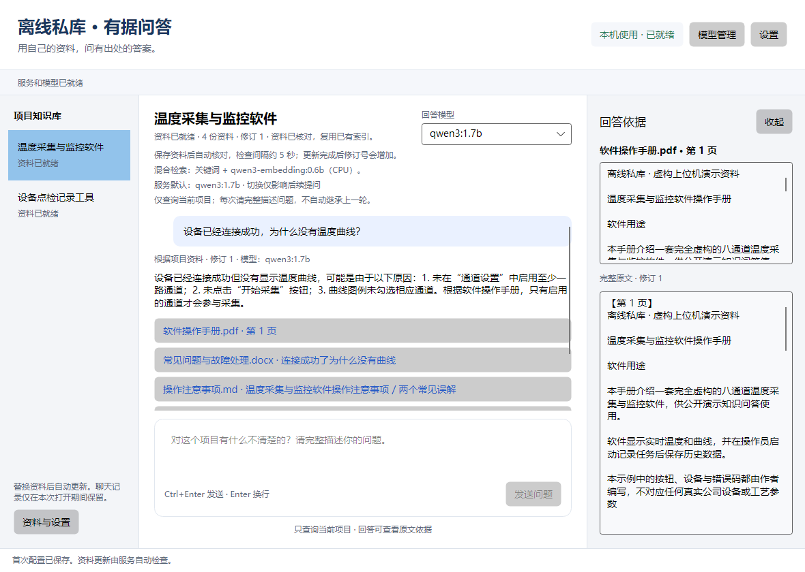
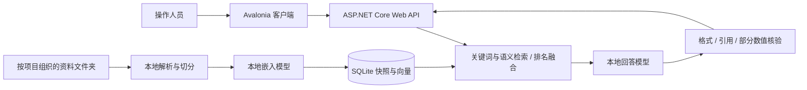

# 离线私库 · 有据问答

**用自己的资料，问有出处的答案。**

一个基于 C#、ASP.NET Core、Avalonia 和 Ollama 的本地知识问答原型。把操作手册、岗位说明等资料按项目放入文件夹，服务自动整理索引；提问时先检索相关原文，再由本地模型整理回答，并提供可打开的原文引用。

适合尝试软件操作手册、岗位交接、内部流程和维护说明的知识问答。资料、问题、向量和回答在服务所在电脑处理；首次安装和下载模型需要联网，准备完成后日常问答可离线使用。

## 界面





首次配置图用于展示真实界面，状态测试使用明确的虚构数据；问答图由随包的温度采集与监控软件虚构资料与真实本地模型生成，展示时隐藏开发机目录，不含个人或公司资料。

## 可以做什么

- 首次配置：选择本机或企业方式，检查环境，主动下载缺少的回答/检索模型，选择资料目录。
- 按文件夹划分知识库，自动发现文件更新；显示实际目录、整理进度和资料修订号。
- 支持 UTF-8 TXT/Markdown、DOCX、文字型 PDF、常规 XLSX；表格行保留表头或字段名。
- 关键词与语义混合检索，合并候选排名，按输入预算选择完整片段。
- 回答附原文引用，可查看对应版本全文；资料更新期间阻止返回旧版本答案。
- 本机模式自动准备配套 API，关闭时仅停止自己启动的 API；企业客户端只连接 IT 管理的服务。
- 从 Ollama 官方目录浏览聊天模型；首次配置单独准备服务指定的嵌入模型。
- 用户主动取消、超时说明、错误码与带单位数值的保守依据检查。

这是可运行的公开原型，不保证模型的每句话都正确。引用合法不等于结论一定受原文支持；资料不完整、问法复杂或模型较小时，仍可能误拒答或补充未明确记载的解释。详见 [限制与评估](docs/LIMITATIONS.md)。

## 普通用户：下载后使用

1. 在仓库的 Releases 中下载 `offline-private-knowledge-v0.1.1-win-x64.zip`。
2. 完整解压到有写入权限的目录，运行 `PrivateKnowledge.Desktop.exe`，保留旁边的 `service` 文件夹。
3. 按首次配置页面完成检查。缺少 Ollama 时打开官方安装页；模型仅在点击下载后准备。
4. 选择自己的资料根目录，或者点击“体验随包虚构示例”。每个一级子文件夹是一套知识库。
5. 等待选定项目显示“资料已就绪”，再提问并核对原文。

Windows 包包含客户端与 API 所需 .NET 运行时，不需要安装开发 SDK；不包含 Ollama 和模型。首次配置完成后，下次直接进入主界面。已有旧配置继续兼容，可在设置中重新打开首次配置。

运行环境、磁盘与模型位置说明见 [快速开始](docs/QUICKSTART.md)。

## 开发者：源码运行

当前开发基线为 .NET SDK 9.0.300，沿用已有 .NET 9 工程；Avalonia 11.3.8。Windows 是本轮验证平台，其他系统尚未完成发布验收。

```powershell
dotnet restore .\PrivateKnowledge.sln
dotnet build .\PrivateKnowledge.sln -c Debug --no-restore
dotnet test .\PrivateKnowledge.sln --no-restore
.\start-client.ps1
```

也可用兼容 .NET 9 的 Visual Studio 打开 `PrivateKnowledge.sln`，选择 `PrivateKnowledge.Desktop` 启动。`PrivateKnowledge.Client.sln` 是客户端及其调用库的快捷入口，并非另一套产品。

公开源码默认使用 `PublicSamples`。开发者可在项目根目录自行创建 `SampleKnowledge` 保存本机资料，该目录被 Git 忽略。运行时以界面显示的实际服务目录为准，避免编辑了另一份同名副本。

## 架构



Ollama 为两个模型提供本地运行接口；模型文件、原资料和 SQLite 是不同内容。资料变化触发重新整理，不是对回答模型重新训练。详细流程见 [架构与代码阅读](docs/ARCHITECTURE.md)。

## 配置和部署

- 默认回答模型：`qwen3:1.7b`；可在客户端选择其他已安装的本地聊天模型。
- 默认检索模型：`qwen3-embedding:0.6b`，不出现在回答模型列表。
- 默认 CPU 嵌入、四片段一批、每批结束释放；可在服务配置中调整硬件和驻留策略。
- 企业方式是共享密钥访问同一实例，尚无个人账号和项目级权限；模型由 IT 维护。

[首次配置与接口](docs/SETUP.md) · [本机和企业部署](docs/DEPLOYMENT.md) · [验证与已知限制](docs/LIMITATIONS.md)

## 构建可分享的版本

在项目目录使用 PowerShell 7：

```powershell
pwsh -File .\scripts\build-release.ps1
```

脚本先生成全新的公开源码副本，再在另一份构建目录编译，输出源码 ZIP、Windows x64 自带运行时 ZIP、SHA256 和公开文件清单。发布样例只来自 `PublicSamples`，不会复制开发者的 `SampleKnowledge`。

只整理公开源码：

```powershell
pwsh -File .\scripts\export-source.ps1 -Destination 'D:\PublicBuild\OfflinePrivateKnowledge'
```

目标目录必须尚不存在，防止把旧文件混进新版本。更多步骤见 [发布说明](docs/RELEASING.md)。

## 项目状态与参与

当前为 v0.1.1 原型：已具备本地知识整理、检索、问答、引用和首次配置流程。项目使用 AI 工具协助实现；技术选择、运行边界和验证结果在文档中保留，不把模拟结果或小样本结果当成生产效果。

欢迎通过 Issues 提交可公开的最小复现。请用虚构资料代替个人档案、公司文件、密钥和聊天记录。提交改动前运行相应测试，并保留便于学习的中文注释。

## 许可证

项目源码采用 [MIT](LICENSE)。依赖库、Ollama 和各模型遵循各自许可证；运行包的 `licenses` 目录保留实际 NuGet 依赖声明与随包许可文件。模型权重不随本项目分发。
